# Manual de usuario - Administrador de Modelos LADM-COL 3.0

**Agencia Catastral de Cundinamarca (ACC)**

Este manual explica cómo usar la herramienta para validar archivos XTF, crear esquemas LADM-COL en
PostgreSQL, cargar los datos y volver a generar los XTF. Está pensado para el personal técnico que
recibe y procesa las entregas catastrales por municipio.

## Contenido

1. [Conceptos básicos](#1-conceptos-básicos)
2. [Instalación](#2-instalación)
3. [Primer uso: configuración](#3-primer-uso-configuración)
4. [La ventana principal](#4-la-ventana-principal)
5. [Paso 1 - Validar XTF](#5-paso-1---validar-xtf)
6. [Paso 2 - Crear esquema](#6-paso-2---crear-esquema)
7. [Paso 3 - Importar XTF](#7-paso-3---importar-xtf)
8. [Paso 4 - Exportar XTF](#8-paso-4---exportar-xtf)
9. [Ejemplo completo: cargar y actualizar un municipio](#9-ejemplo-completo-cargar-y-actualizar-un-municipio)
10. [Línea de comandos](#10-línea-de-comandos)
11. [Archivos que genera la herramienta](#11-archivos-que-genera-la-herramienta)
12. [Solución de problemas](#12-solución-de-problemas)
13. [Preguntas frecuentes](#13-preguntas-frecuentes)

---

## 1. Conceptos básicos

| Término | Significado |
|---------|-------------|
| **XTF** | Archivo de transferencia INTERLIS con los datos de un municipio. Puede llegar dentro de un `.zip`. |
| **Modelo INTERLIS (.ili)** | Define la estructura de los datos, por ejemplo `Modelo_Aplicacion_LADMCOL_SINIC_V1_0`. |
| **Perfil de modelo** | Configuración guardada en la herramienta: carpeta de modelos `.ili`, modelos a usar y opciones de ili2pg. Ejemplos: "SINIC", "Interno ACC". |
| **Esquema** | Espacio dentro de la base de datos PostgreSQL donde quedan las tablas, por ejemplo `cun25279`. |
| **Dataset** | Etiqueta que identifica los datos de un municipio dentro de un esquema. Es el código DIVIPOLA, por ejemplo `25279`. |
| **Código DIVIPOLA** | Código de 5 dígitos del municipio. La herramienta lo detecta en el nombre del archivo o de su carpeta. |
| **ili2pg / ilivalidator** | Programas oficiales de INTERLIS que hacen el trabajo de fondo. La herramienta los descarga y los ejecuta por usted. |

El trabajo sigue cuatro pasos, que aparecen numerados en la barra lateral:

```
1. Validar XTF  →  2. Crear esquema  →  3. Importar XTF  →  4. Exportar XTF
```

---

## 2. Instalación

### Requisitos

| Componente | Versión | Cómo verificar |
|------------|---------|----------------|
| Windows | 10/11 64-bit | - |
| Python | 3.10 o superior | `python --version` (al instalar marque *Add Python to PATH*) |
| Java | 8 o superior | `java -version` |
| PostgreSQL | 12 o superior, con PostGIS | página *Inicio* de la herramienta |

### Pasos

1. Obtenga la herramienta: clone el repositorio o descomprima el paquete entregado.
2. Haga doble clic en `windows_version\ejecutar_administrador.bat`. La primera vez:
   - instala los componentes de Python (`requirements.txt`);
   - descarga **ili2pg 5.5.1** e **ilivalidator 1.15.0** desde `downloads.interlis.ch`, verificando que
     los archivos no estén dañados ni alterados (huella SHA-256).
3. Se abre la ventana en la página **Inicio**.

> **Sin internet:** copie la carpeta `windows_version\ili2pg\` desde otro equipo donde ya esté instalada,
> o indique la ruta de los JAR en *Configuración → Herramientas y general*.

---

## 3. Primer uso: configuración

Abra **Configuración** en la barra lateral.

### 3.1 Conexión a la base de datos

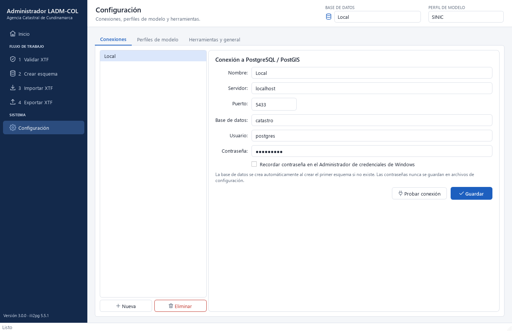

1. Pulse **Nueva** y complete servidor, puerto, base de datos, usuario y contraseña.
2. Marque **Recordar contraseña** para guardarla en el Administrador de credenciales de Windows. Si no la
   marca, la herramienta la pedirá una vez cada vez que se abra.
3. Pulse **Probar conexión**. Debe ver la versión de PostgreSQL y de PostGIS.
4. Pulse **Guardar**.

Si la base de datos no existe todavía, no hay problema: se crea al crear el primer esquema.

### 3.2 Perfil de modelo

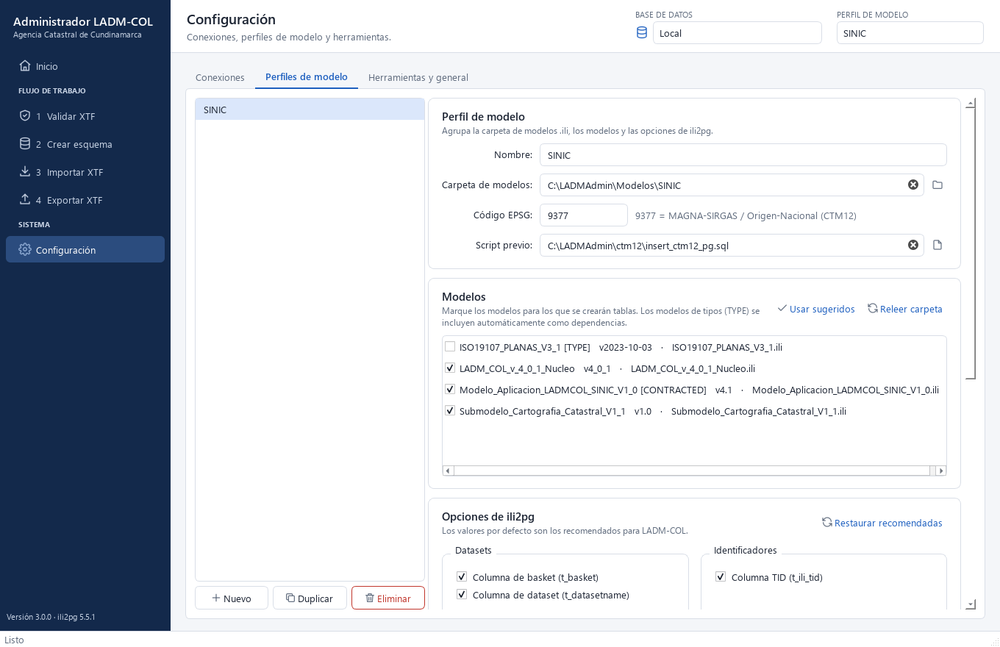

En el primer arranque se crea automáticamente un perfil por cada carpeta de `Modelos\`, por ejemplo
"SINIC". Para crear otro, como el del modelo interno ACC:

1. Pulse **Nuevo** y escriba el nombre.
2. En **Carpeta de modelos** elija la carpeta con los archivos `.ili`.
3. Pulse **Usar sugeridos**: marca todos los modelos con contenido propio. Los modelos marcados `[TYPE]`
   no necesitan marcarse.
4. Revise el **código EPSG** (9377 por defecto) y el **script previo** (CTM12).
5. Deje las **Opciones de ili2pg** como están, salvo que sepa lo que cambia. En particular, *Columna de
   basket* debe quedar activa: los modelos SINIC e Interno ACC la exigen.
6. Pulse **Guardar perfil**.

> Si aparece el aviso "El modelo X está definido en varios archivos", deje un solo archivo con ese
> modelo en la carpeta.

### 3.3 Herramientas y general

En la pestaña **Herramientas y general** puede:
- cambiar el **prefijo de esquemas** (por defecto `cun`, que da `cun25279`);
- elegir la carpeta de logs y el tema (claro, oscuro o según Windows);
- aumentar la memoria de Java para archivos muy grandes;
- **importar perfiles de la versión 2.0**, si usaba la herramienta anterior.

---

## 4. La ventana principal

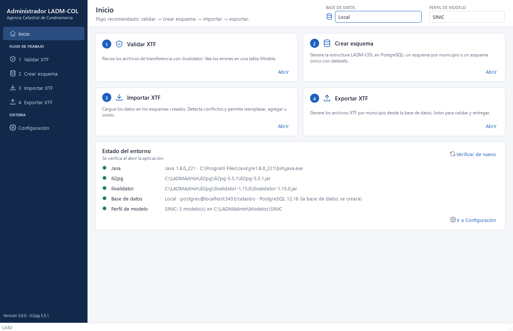

- **Barra lateral:** los cuatro pasos del flujo y la configuración.
- **Parte superior derecha:** la **base de datos** y el **perfil de modelo** activos. Todas las
  operaciones usan esta selección; cámbiela aquí cuando trabaje con otra base o con otro modelo.
- **Inicio:** resume el estado del entorno. Todos los puntos deben estar en verde antes de trabajar. Si
  faltan ili2pg o ilivalidator aparece el botón **Descargar herramientas**.

En cada paso la pantalla tiene el mismo esquema:
- arriba, el formulario;
- abajo, las pestañas **Resultados** (un renglón por elemento procesado) y **Registro** (detalle técnico,
  filtrable);
- una barra con el progreso y los botones **Detener** y de ejecución.

Clic derecho sobre un resultado permite abrir su log o mostrar el archivo generado.

---

## 5. Paso 1 - Validar XTF

Revise los archivos recibidos antes de cargarlos.

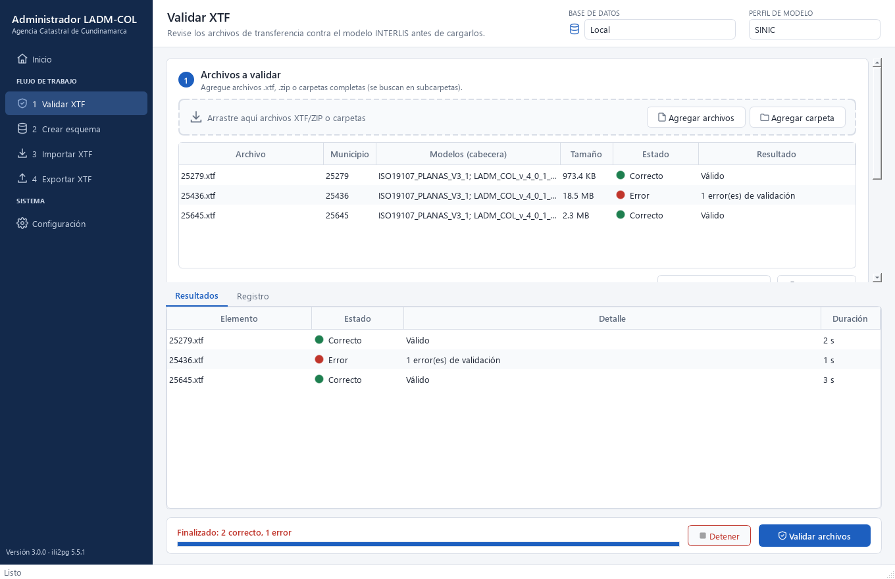

1. Agregue archivos con **Agregar archivos** o **Agregar carpeta**, o arrástrelos a la zona punteada. Se
   aceptan `.xtf`, `.zip` y carpetas completas (se buscan en subcarpetas).
2. La tabla muestra el municipio detectado, los modelos declarados en el archivo y su tamaño.
3. En **Modelos**, normalmente deje *Usar la carpeta del perfil activo*.
4. Pulse **Validar archivos**.

Cada archivo termina como **Correcto** (válido) o **Error**. **Haga doble clic** en un archivo con errores
para ver el detalle:

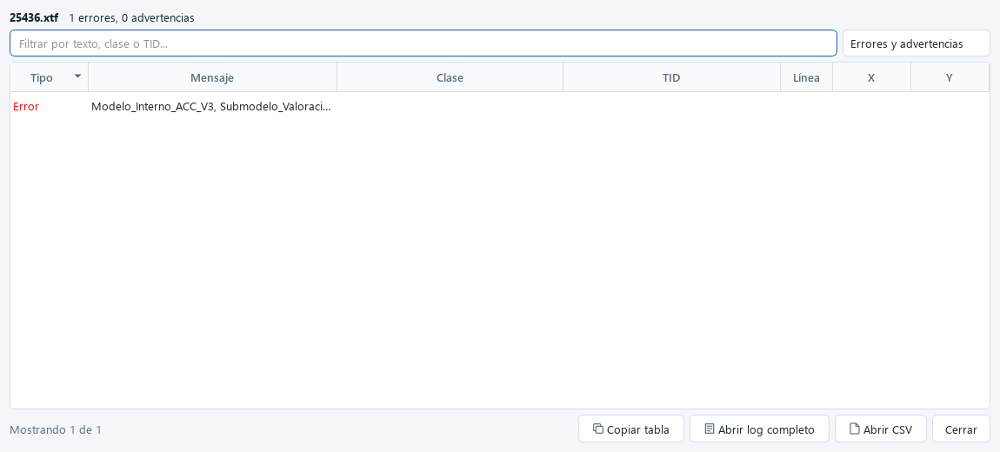

En esa ventana puede filtrar por texto, clase o TID; copiar la tabla para pegarla en Excel; o abrir el
log completo. En el ejemplo, el archivo `25436.xtf` usa el modelo Interno ACC y se validó con el perfil
SINIC: el error `model(s) not found` indica que esos modelos no están en la carpeta. Para corregirlo, valídelo con el perfil
del modelo correcto.

**Opciones avanzadas:**
- *Verificar referencias entre todos los objetos*: reporta objetos que apuntan a otros que no están en el
  archivo.
- *Reporte en formato XTF*: genera además un archivo XTF con los errores.

Al terminar, el aviso verde **Ir a Importar →** lleva los archivos válidos al paso 3.

---

## 6. Paso 2 - Crear esquema

Crea en la base de datos las tablas vacías donde se cargarán los datos.

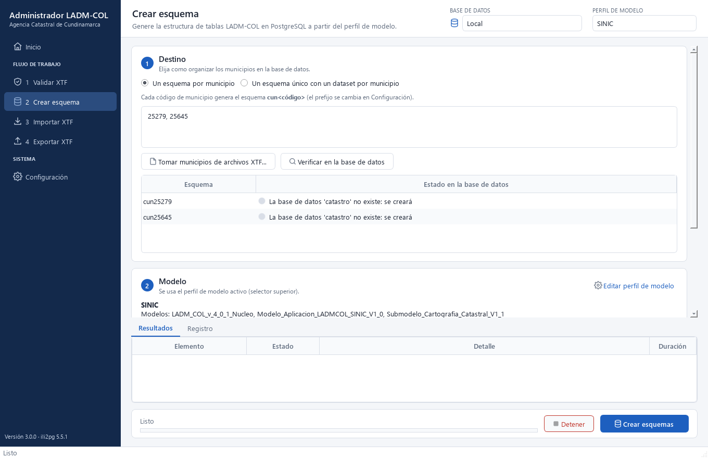

1. **Destino.** Elija cómo organizar los municipios:
   - **Un esquema por municipio:** escriba los códigos DIVIPOLA (`25279, 25645`) o pulse *Tomar
     municipios de archivos XTF*. Cada código genera `cun<código>`.
   - **Un esquema único:** escriba un nombre, por ejemplo `sinic_cundinamarca`. Todos los municipios
     quedarán en él, cada uno en su propio dataset.
2. Pulse **Verificar en la base de datos** para ver si los esquemas ya existen y si tienen datos.
3. Revise el bloque **Modelo**: muestra el perfil que se usará.
4. **Si el esquema ya existe**, elija qué hacer:

   | Opción | Efecto |
   |--------|--------|
   | Preguntar en cada caso | Muestra un diálogo por cada esquema existente. |
   | Omitir | No toca el esquema. |
   | Actualizar estructura | Agrega lo que falte sin borrar datos. |
   | Recrear | Borra el esquema y sus datos y lo crea de nuevo. |

   **Recrear es seguro:** el esquema original se guarda como respaldo y solo se elimina si la nueva
   creación termina bien. Si falla, se restaura.
5. Pulse **Crear esquemas** y confirme.

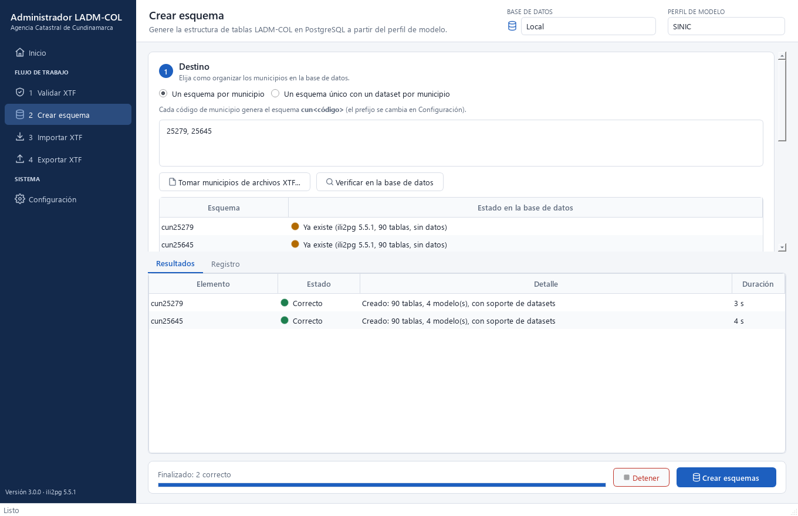

El resultado indica cuántas tablas se crearon. Para el modelo SINIC son 90 tablas y 4 modelos. La
sección plegable *Vista previa del comando ili2pg* muestra el comando exacto que se ejecuta.

---

## 7. Paso 3 - Importar XTF

Carga los datos de los XTF en esquemas **ya creados**. La importación nunca crea esquemas.

### 7.1 Destino y archivos

1. En **Destino** elija el mismo modo que usó al crear: *Un esquema por municipio* o *Esquema único*. En
   este último, elija el esquema; el botón ↻ carga la lista desde la base de datos.
2. Agregue los archivos. La herramienta los **analiza sin escribir nada** y muestra el plan:

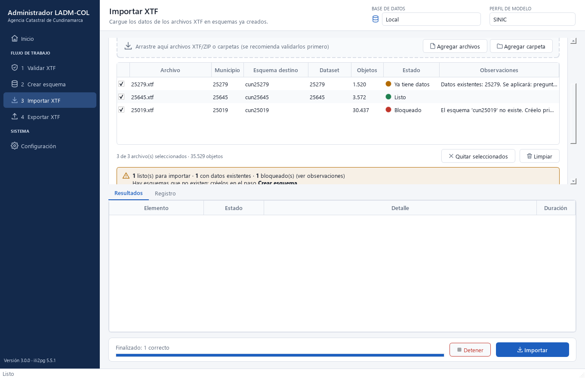

| Estado | Qué significa | Qué hacer |
|--------|---------------|-----------|
| 🟢 **Listo** | El esquema existe, es compatible y no tiene datos de ese municipio. | Nada. |
| 🟠 **Ya tiene datos** | El municipio ya fue cargado antes. | Elegir qué hacer (7.2). |
| 🔴 **Bloqueado** | No se puede importar; el motivo está en *Observaciones*. | Corregir y volver a analizar. |

Motivos de bloqueo frecuentes:
- *El esquema no existe*: créelo en el paso 2.
- *Modelos del XTF que no están en el esquema*: el archivo es de otro modelo. Use el perfil y el esquema
  correctos.
- *Clases del XTF sin tabla en el esquema*: el esquema se creó con un perfil incompleto. Use *Usar
  sugeridos* en el perfil y recree el esquema.
- *Otro archivo del lote ya importa a este destino*: hay dos archivos del mismo municipio. Deje solo uno.

Puede **corregir el esquema o el dataset con doble clic** en la celda, **excluir** archivos quitando la
marca, y ver los **objetos por clase** con clic derecho.

### 7.2 Si el destino ya tiene datos

| Opción | Efecto |
|--------|--------|
| **Preguntar en cada caso** | Muestra el diálogo de abajo por cada archivo en conflicto. |
| **Reemplazar** | Borra los datos de ese municipio y carga el archivo. Es todo o nada: si la carga falla, los datos anteriores quedan intactos. |
| **Agregar como nuevo dataset** | Conserva lo existente y agrega el archivo con otro nombre de dataset (`25279_2`). Falla si el archivo repite predios ya cargados. |
| **No importar** | Omite el archivo. |

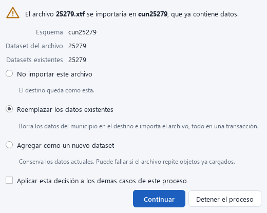

Marque *Aplicar esta decisión a los demás casos* para no responder lo mismo varias veces. *Detener el
proceso* cancela todo lo que falta.

### 7.3 Opciones avanzadas y resultado

- *Validar los datos durante la importación* (recomendado, activo por defecto).
- *Verificar que los conteos por clase coincidan con el XTF* (activo por defecto).
- *Omitir errores de referencia / geometría*: solo para cargas de diagnóstico.

Pulse **Importar** y confirme.

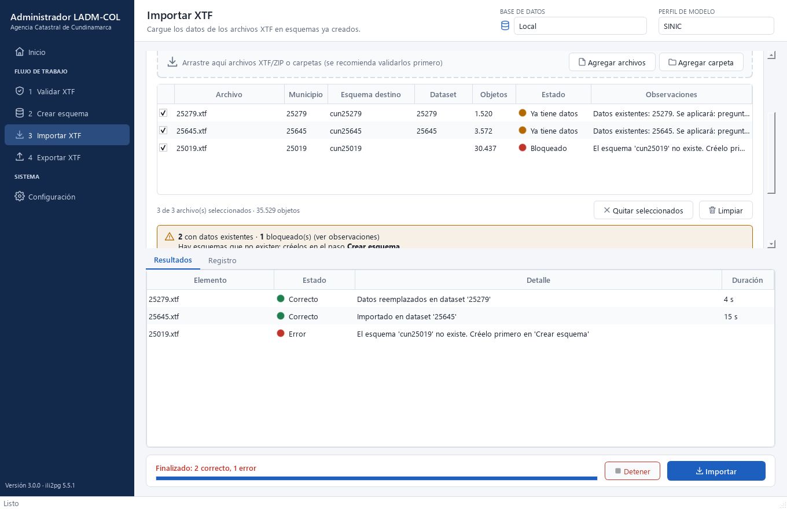

Cada archivo muestra si se importó, si reemplazó datos y cuánto tardó. Los archivos bloqueados aparecen
como **Error** con su motivo. Si los conteos no coinciden, el archivo queda en **Con advertencias** y la
pestaña *Registro* indica las tablas con diferencias.

---

## 8. Paso 4 - Exportar XTF

Genera archivos XTF desde la base de datos.

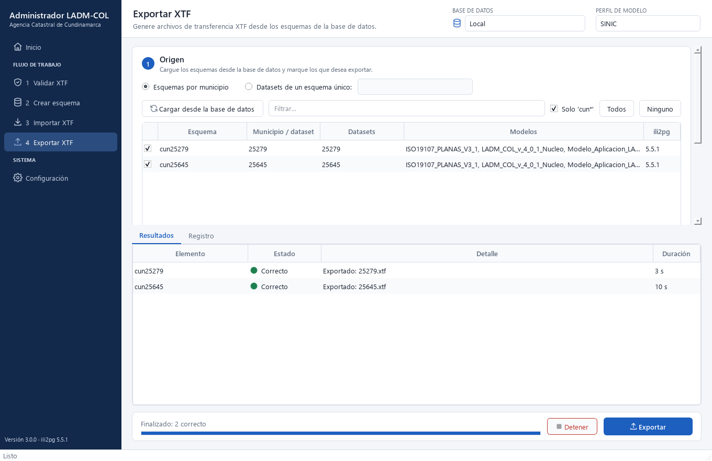

1. Elija el origen: *Esquemas por municipio* o *Datasets de un esquema único*.
2. Pulse **Cargar desde la base de datos**. Se listan los esquemas o datasets con su versión de ili2pg y
   sus modelos. Use el filtro, *Solo 'cun\*'*, *Todos* o *Ninguno* para marcar.
3. Elija la **carpeta de salida**. Se crea una subcarpeta por municipio: `<salida>\<código>\<código>.xtf`.
4. En *Opciones avanzadas*:
   - *Exportar los TID originales* (recomendado): conserva los identificadores de cada objeto.
   - *Validar durante la exportación*.
5. Pulse **Exportar**.

Al terminar, **Validar archivos exportados →** los envía al paso 1 para una revisión final.

---

## 9. Ejemplo completo: cargar y actualizar un municipio

**Situación:** llega la entrega `25279.zip` del municipio 25279 y se quiere cargar en la base `catastro`
con el modelo SINIC.

1. Arriba, seleccione la base **catastro** y el perfil **SINIC**.
2. **Validar:** agregue `25279.zip` y pulse *Validar archivos*. Si sale *Error*, haga doble clic, revise
   los errores y solicite la corrección. Si sale *Correcto*, pulse **Ir a Importar →**.
3. **Crear esquema** (solo la primera vez): escriba `25279`, verifique y pulse *Crear esquemas*.
4. **Importar:** el plan muestra `25279.xtf → cun25279 · dataset 25279 · Listo`. Pulse *Importar*. El
   resultado debe decir *Importado en dataset '25279'* y los conteos deben coincidir.
5. **Exportar** (si se requiere entregar): cargue los esquemas, marque `cun25279`, elija la carpeta y
   pulse *Exportar*.

**Meses después llega una nueva entrega del mismo municipio:** valide el archivo y vaya directo a
**Importar**. El plan dirá *Ya tiene datos*; elija **Reemplazar** e importe. No hace falta recrear el
esquema.

---

## 10. Línea de comandos

Para procesos repetitivos o programados. Usa las mismas conexiones y perfiles de la interfaz.

```cmd
ejecutar_administrador.bat listar                 :: conexiones y perfiles guardados
ejecutar_administrador.bat herramientas           :: descarga ili2pg/ilivalidator si faltan
ejecutar_administrador.bat validar <rutas...> [--perfil P] [--modeldir D] [--modelos A;B] [--todos-accesibles]
ejecutar_administrador.bat crear --esquemas cun1,cun2 [--conexion C] [--perfil P] [--si-existe omitir|actualizar|recrear]
ejecutar_administrador.bat importar <rutas...> [--conexion C] [--perfil P] [--esquema-unico E]
        [--si-hay-datos cancelar|reemplazar|agregar] [--sin-validacion] [--solo-analizar]
ejecutar_administrador.bat exportar --salida DIR (--esquemas a,b | --todos | --esquema-unico E)
```

- Sin `--conexion` ni `--perfil` se usan los activos en la interfaz.
- `importar --solo-analizar` muestra el plan (destino y estado de cada archivo) sin importar.
- `exportar --esquema-unico E` exporta todos los datasets de ese esquema.
- La contraseña se toma del Administrador de credenciales, de la variable `LADM_PGPASSWORD` o se pide
  por consola.
- El código de salida es 1 si algún elemento falló, útil en tareas programadas.

Ejemplo: revisar el plan y luego reemplazar los municipios de una carpeta.

```cmd
ejecutar_administrador.bat importar D:\entregas\noviembre --conexion catastro --perfil SINIC --solo-analizar
ejecutar_administrador.bat importar D:\entregas\noviembre --conexion catastro --perfil SINIC --si-hay-datos reemplazar
```

---

## 11. Archivos que genera la herramienta

| Qué | Dónde |
|-----|-------|
| Reporte de validación | Junto al XTF: `<nombre>_validacion.log` y `.csv`. Si el XTF venía en un ZIP, junto al ZIP: `<zip>_<xtf>_validacion.log`. |
| Logs de creación de esquemas | `<carpeta de logs>\crear_esquema\` |
| Logs de importación | `<carpeta de logs>\importar\` |
| XTF exportados y su log | `<salida>\<código>\<código>.xtf` y `<código>_exportacion.log` |
| XTF extraídos de los ZIP | `%LOCALAPPDATA%\LADMAdmin\trabajo\` (se pueden borrar sin problema) |
| Configuración (sin contraseñas) | `%APPDATA%\LADMAdmin\settings.json` |
| Contraseñas | Administrador de credenciales de Windows, servicio `LADMAdmin` |

La carpeta de logs por defecto es `windows_version\log\`; se cambia en *Configuración → Herramientas y
general*.

---

## 12. Solución de problemas

| Mensaje o síntoma | Causa y solución |
|-------------------|------------------|
| `Model ... requires column T_basket` | Active *Columna de basket* en el perfil y vuelva a crear el esquema. |
| Esquema "creado con ili2pg 4.x" | Recree el esquema con la versión 5.5.1; mezclar versiones puede fallar. |
| `llave duplicada viola restricción de unicidad` al agregar | El archivo ya estaba cargado. Use *Reemplazar*. |
| `no existe la relación ...` | El esquema se creó sin todos los modelos. Use *Usar sugeridos* en el perfil y recree el esquema. |
| La validación reporta `model(s) not found` | El XTF es de otro modelo. Use el perfil correcto, por ejemplo "Interno ACC" en lugar de "SINIC". |
| No se encontró Java | Instale Java 8+ o indique su ruta en Configuración → Herramientas y general. |
| ili2pg / ilivalidator no encontrado | Pulse *Descargar herramientas* en Inicio o ejecute `ejecutar_administrador.bat herramientas`. |
| La huella SHA-256 no coincide | La descarga se dañó o el archivo fue alterado. Vuelva a intentarlo; no se instala nada. |
| Se pide la contraseña cada vez que se abre la herramienta | Marque *Recordar contraseña* en la conexión. |
| Proceso muy lento o sin memoria con XTF grandes | Aumente la *Memoria máxima Java* en Herramientas y general. |

Para el detalle técnico de un error, abra la pestaña **Registro** con el filtro *Detallado*, o el log
del elemento con clic derecho sobre el resultado.

**Nota de seguridad:** ili2pg solo acepta la contraseña por línea de comandos. La herramienta la oculta
en pantalla y en los logs, pero mientras se ejecuta es visible para el mismo usuario en el administrador
de tareas.

---

## 13. Preguntas frecuentes

**¿Qué modo de almacenamiento uso?**
*Un esquema por municipio* cuando cada municipio se trabaja y entrega por separado. *Esquema único* cuando
se necesitan consultas de todo el departamento o se quiere tener menos tablas. Puede usar ambos en bases
distintas.

**¿Puedo detener un proceso a la mitad?**
Sí, con **Detener**. El elemento en curso se cancela; lo ya terminado se conserva. Una importación
interrumpida no deja datos a medias: se deshace completa.

**¿Qué pasa si cierro la ventana con un proceso en ejecución?**
La herramienta pide confirmación y, si acepta, detiene el proceso.

**¿Dónde configuro el modelo interno ACC?**
Cree un perfil de modelo que apunte a la carpeta de sus `.ili` (sección 3.2) y selecciónelo arriba
antes de trabajar con esos archivos.

**¿La herramienta revisa las reglas de negocio del SINIC (IGAC)?**
No. Valida contra el modelo INTERLIS. Las reglas adicionales del proceso de novedades del IGAC no se
verifican.

---

**Agencia Catastral de Cundinamarca - Área de Desarrollo**
